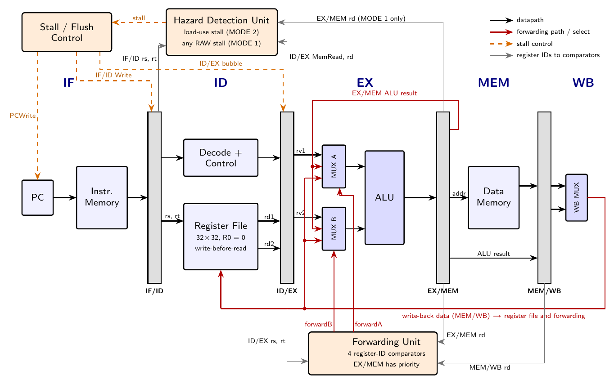

# Pipeline Hazard Detection and Forwarding Unit

A Verilog HDL implementation and verification study of data-hazard handling in a 32-bit, five-stage MIPS-style processor pipeline. The project compares a stall-only interlock with a forwarding-based design that uses EX/MEM and MEM/WB bypass paths and inserts a stall for load-use dependencies.

> **Project:** Project 4 — Pipeline Hazard Detection and Forwarding Unit  
> **Institution:** Newton School of Technology, Rishihood University  
> **Team:** Jashvitha, Chaitanya, Palak, and Samarth  
> **Final IEEE report:** [`IEEE_REPORT/Final_IEEE_Project_Report.pdf`](IEEE_REPORT/Final_IEEE_Project_Report.pdf)  
> **Phase I report archive:** [`IEEE_REPORT/IEEE_Phase1_Report.pdf`](IEEE_REPORT/IEEE_Phase1_Report.pdf)  
> **Project demonstration:** [Open the Google Drive demo folder](https://drive.google.com/drive/folders/1EA9PCPPloYlrJTbqLjpsD-cKfEhgSg1B)

## Overview

Pipelining allows multiple instructions to progress through different processor stages at the same time. However, a read-after-write (RAW) dependency occurs when an instruction needs a register value that an earlier instruction has not written back yet. Without hazard handling, the dependent instruction may read stale data.

This project implements and evaluates three hazard-handling policies on the same five-stage datapath:

- **MODE 0 — No hazard handling:** a negative-control configuration that does not resolve RAW dependencies. It is expected to produce incorrect results for programs containing hazards.
- **MODE 1 — Stall-only:** detects RAW dependencies with instructions in EX or MEM and stalls until the producer reaches write-back. This is the correct baseline without forwarding.
- **MODE 2 — Forwarding + load-use interlock:** forwards available results from EX/MEM or MEM/WB and inserts a one-cycle stall when an instruction immediately depends on a load in EX.

The proposed design is MODE 2. The same processor and test programs are used to compare the policies.

## Architecture

The processor follows the classic five-stage organization:

| Stage | Name | Main responsibility |
|---|---|---|
| IF | Instruction Fetch | Fetch the instruction using the program counter |
| ID | Instruction Decode | Decode the instruction and read register operands |
| EX | Execute | Perform ALU operations and resolve forwarding selections |
| MEM | Memory Access | Read from or write to data memory |
| WB | Write Back | Write the result back to the register file |



### Main hazard-handling mechanisms

**Register-ID comparison**  
The comparator checks whether a producer writes a non-zero destination register that is actually read by the consumer. Source-operand usage is considered so unused instruction fields do not create false dependencies. Register `$0` is excluded from dependency generation.

**Forwarding paths**  
MODE 2 provides two forwarding sources for the EX-stage operands:

| `forwardA` / `forwardB` | Operand source |
|---|---|
| `2'b00` | Register-file value latched in ID/EX |
| `2'b10` | EX/MEM ALU result |
| `2'b01` | MEM/WB write-back value |

EX/MEM has priority over MEM/WB because it contains the more recent result when both stages match the same source register. A load in EX/MEM is not used as a forwarding source because that stage contains the load address, not the loaded data. Operand-B forwarding also supports store-data dependencies covered by the directed tests.

**Load-use interlock**  
A load-use dependency occurs when the instruction in ID reads the destination register of a load in EX. MODE 2 stalls for one cycle, holds the PC and IF/ID instruction, and injects a bubble into ID/EX. Once the data reaches MEM/WB, it can be forwarded to the dependent instruction.

**Stall and flush control**  
The stall/flush controller generates `PCWrite`, `IF/IDWrite`, `IF/IDFlush`, and the ID/EX bubble control. In the current implementation, the flush input is tied low in `processor_top.v`; branch instructions and control-hazard handling are not implemented. The flush interface remains an integration point, but branch flushing is not part of the verified design.

## Supported instruction subset

This is an educational MIPS-style subset, not a complete MIPS implementation.

| Instruction | Operation |
|---|---|
| `ADD` | Register addition |
| `SUB` | Register subtraction |
| `AND` | Bitwise AND |
| `OR` | Bitwise OR |
| `ADDI` | Add immediate |
| `LW` | Load a word from data memory |
| `SW` | Store a word to data memory |
| `NOP` | No operation |

Unsupported opcodes and unsupported R-type function codes are treated as NOPs. The processor uses a 32-bit datapath, a 32-entry 32-bit register file with `$0` hard-wired to zero, and 256-word instruction and data memory arrays. The program counter is a byte address that advances by four; memory arrays are indexed using address bits `[9:2]`.

## Repository structure

```text
.
├── README.md
├── IEEE_REPORT/
│   ├── Final_IEEE_Project_Report.pdf
│   ├── Final_IEEE_Project_Report.tex
│   └── IEEE_Phase1_Report.pdf          # archived phase I submission
├── DemoVideo/
│   └── Video.md                        # Google Drive demo link
├── rtl/                                # Verilog modules
├── testbench/                          # unit and processor testbenches
├── scripts/                            # helper and figure-generation scripts
├── docs/
│   ├── figures/block_diagram.png
│   └── hazard_cases.md
├── reports/                            # performance CSV files
├── simulation/
│   ├── logs/
│   ├── results/
│   └── waveforms/
├── waveforms/layouts/                  # GTKWave layouts
└── contributions/                      # per-member evidence screenshots
```

## Requirements

### Required

- Bash
- [Icarus Verilog](https://steveicarus.github.io/iverilog/) (`iverilog` and `vvp`)

### Optional

- [GTKWave](https://gtkwave.sourceforge.net/) to inspect VCD waveforms and saved waveform layouts
- Python 3 and Matplotlib to generate CPI and waveform figures from the saved simulation outputs

On macOS, Icarus Verilog can be installed with Homebrew:

```bash
brew install icarus-verilog
```

On Debian/Ubuntu Linux:

```bash
sudo apt-get update
sudo apt-get install iverilog
```

## Run the complete regression

From the repository root:

```bash
chmod +x run_all.sh
./run_all.sh
```

The script accepts an optional number of random-program seeds. The default is 100:

```bash
./run_all.sh 250
```

The regression performs the following steps:

1. Compiles the processor in MODE 0, MODE 1, and MODE 2, plus the unit-test benches.
2. Runs the forwarding/comparator/multiplexer, hazard-detection/stall-flush, and ALU/register-file unit tests.
3. Runs 16 directed programs in all three modes.
4. Runs seeded 40-instruction random programs against the instruction-level golden model in MODE 1 and MODE 2. MODE 0 is run as a negative control for up to 20 seeds.
5. Saves selected pipeline traces and VCD waveform files.
6. Writes performance CSV files and prints the aggregate comparison.

MODE 1 and MODE 2 are expected to pass the directed and random correctness checks. MODE 0 is intentionally not hazard-safe; failures on dependency-containing programs are expected and demonstrate why hazard handling is required. The script exits with a non-zero status if a required compile, unit test, MODE 1 test, or MODE 2 test fails.

## Run individual tests and inspect results

The helper script provides shortcuts for common demonstrations:

```bash
# Show the directed hazard-case catalogue
./scripts/show.sh catalogue

# Run unit tests individually
./scripts/show.sh unit-fwd
./scripts/show.sh unit-hdu
./scripts/show.sh unit-rfalu

# Run directed Test 3 in MODE 2 and print a cycle-by-cycle trace
./scripts/show.sh test 3 2 trace

# Regenerate the CSV results and print the MODE 1 vs MODE 2 CPI table
./scripts/show.sh cpi-table

# Show selected seeded random-program comparisons
./scripts/show.sh random
```

For a manual simulation run:

```bash
mkdir -p simulation/build
iverilog -g2012 -Wall -P tb_processor.MODE=2 \
  -o simulation/build/tb_mode2 \
  testbench/tb_processor.v rtl/*.v

vvp simulation/build/tb_mode2 +TEST=3 +REPORT +TRACE
```

## Verification strategy

Verification combines unit-level checks with processor-level tests.

### Unit tests

| Testbench | Scope | Recorded checks |
|---|---|---:|
| `tb_forwarding_unit.v` | Register-ID comparator, forwarding priority, forwarding selection, and forwarding mux | 32,192 vectors |
| `tb_hazard_detection_unit.v` | Hazard detection across MODE 0/1/2 and stall/flush control | 28,196 vectors per mode |
| `tb_regfile_alu.v` | ALU operations and register-file behavior | 40,006 ALU vectors and 65 register-file checks |

The counts above are from the checked-in simulation logs in `simulation/logs/`.

### Directed processor tests

Sixteen directed programs cover representative dependency and scheduling cases. The catalogue, including expected stalls, forwarding events, and checked results, is in [`docs/hazard_cases.md`](docs/hazard_cases.md).

Coverage includes:

- EX/MEM forwarding for an adjacent ALU dependency
- MEM/WB forwarding for a dependency separated by one instruction
- EX/MEM priority when two in-flight instructions write the same register
- Load-use interlock behavior
- Register `$0` dependency exclusion
- Independent instructions with no false stall
- Load, independent instruction, then dependent instruction
- Load-to-store data dependency
- ALU result forwarded to store data
- ALU and load dependency chains
- Immediate-to-register dependency
- Unsupported instruction encodings treated as NOPs
- Naive and scheduled vector-add instruction sequences

### Randomized processor tests

The checked-in regression contains 100 deterministic seeds, each generating a 40-instruction program for MODE 1 and MODE 2. Both configurations are compared with an instruction-level golden model and match on all 100 programs. The testbench also checks modeled stall/forwarding/cycle behavior. MODE 0 is run on 20 seeds as a negative control; all 20 runs fail architectural comparison, as expected for a configuration with hazard handling disabled. In the directed suite, MODE 0 fails 13 of 16 programs; the other three do not expose a dependency requiring hazard handling.

## Results

The following figures are taken from the checked-in CSV files produced by the project regression. They describe the current recorded run; rerun `./run_all.sh` to regenerate them after changing the RTL or testbenches.

### Directed programs

| Aggregate across 16 directed tests | MODE 1: Stall-only | MODE 2: Forwarding + load-use stall |
|---|---:|---:|
| Correct directed tests | 16/16 | 16/16 |
| Total cycles | 214 | 158 |
| Stall events | 65 | 9 |
| Forwarding events | 0 | 41 |
| Cycle reduction in MODE 2 | — | 26.2% fewer cycles |
| Cycle-count ratio (MODE 1 / MODE 2) | — | 1.35× |

The cycle totals are summed over the 16 separate test executions, so each test's pipeline fill is included in its own cycle count.

### Random programs

| Aggregate across 100 programs × 40 instructions | MODE 1 | MODE 2 |
|---|---:|---:|
| Instructions | 4,000 | 4,000 |
| Total cycles | 5,851 | 4,546 |
| Aggregate CPI (`total cycles / instructions`) | 1.46275 | 1.13650 |
| Stalls | 1,451 | 146 |
| Forwarding events | 0 | 1,004 |
| Golden-model matches | 100/100 | 100/100 |

These results correspond to the current checked-in `reports/random_regression.csv`. CPI is calculated as total cycles divided by retired instructions and includes the pipeline fill cycles from each separately simulated program. For the directed CSV, `steady_state_cpi` is also recorded as `(cycles - 4) / instructions` to show the CPI after accounting for the four-cycle fill overhead.

## Waveforms and figures

VCD files are stored in `simulation/waveforms/`. GTKWave save files are stored in `waveforms/layouts/`.

Example GTKWave command (requires GTKWave):

```bash
gtkwave simulation/waveforms/test03_mode2.vcd waveforms/layouts/test03_mode2.gtkw
```

To regenerate figures from the checked-in VCD and CSV results, create a Python environment and install Matplotlib:

```bash
python3 -m venv .venv
source .venv/bin/activate
python -m pip install matplotlib
python scripts/make_figures.py docs/figures/generated
```

The script writes a CPI comparison chart and waveform figures for the available VCD files into `docs/figures/generated/`.

To regenerate GTKWave layout files from the VCD files without Matplotlib:

```bash
python3 scripts/make_figures.py --gtkw
```

## Contributions

The team contributions below are recorded in the final report. The `contributions/` directory contains supporting screenshots for the contributors.

| Contributor | Recorded contribution |
|---|---|
| Jashvitha (Team Lead) | Overall microarchitecture and block diagram; hazard detection unit; stall/flush controller; integrated pipeline; processor testbench, golden model, analytical cycle model, stall monitor, random regression, CPI comparison, report and repository coordination |
| Chaitanya | Register-ID comparator; forwarding unit and priority/R0/load rules; forwarding multiplexers; forwarding-unit testbench |
| Palak | ALU; register file and write-before-read bypass; ALU/register-file testbench; literature review |
| Samarth | Directed hazard-case catalogue and expected results; GTKWave layouts; references |

For the complete academic write-up, see the [final IEEE project report](IEEE_REPORT/Final_IEEE_Project_Report.pdf). The earlier [Phase I report](IEEE_REPORT/IEEE_Phase1_Report.pdf) is retained as an archive.

## Current scope and limitations

- The implemented instruction set is a small MIPS-style subset; this is not a complete MIPS processor.
- The implemented instruction subset focuses on data hazards, especially RAW dependencies. Branch instructions and control-hazard handling are not implemented; the processor's flush input is tied low.
- The `LW` followed immediately by a dependent `SW` case is handled correctly with a stall. A dedicated MEM/WB-to-MEM store-data bypass that could remove this stall is not part of the current implementation.
- The repository contains RTL simulation, regression outputs, and waveform evidence. It does not include a completed FPGA board deployment or a synthesis/timing report.

## References

The academic background and bibliography are included in the [final IEEE project report](IEEE_REPORT/Final_IEEE_Project_Report.pdf). The implementation is written in Verilog HDL and is simulated with Icarus Verilog.

---

**Note:** Simulation results in this README describe the artifacts currently committed to the repository. If the RTL or testbenches change, rerun the regression and update the reported metrics from the newly generated CSV files.
